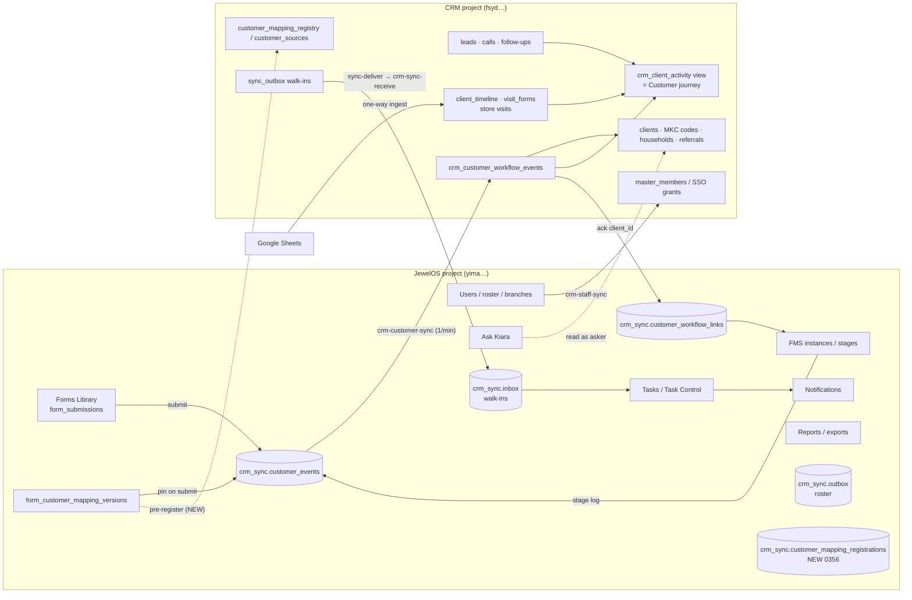

# JewelOS complete integration audit (2026-10-29)

Branch `feat/jewelos-integration-20261029` from `main` `b3eaa43`. Production was read with
read-only, counts-only queries (`begin read only … rollback`). No customer value was printed or
copied. Nothing was written to either hosted project.

Evidence levels used below:

- **PROD-READ**: read-only query on the live project on 2026-10-29.
- **LOCAL-SQL**: pgTAP on throwaway clones of the schema-only validation databases.
- **UNIT**: Vitest / Deno tests.
- **NOT VERIFIED**: needs the hosted pilot (section 7) or a device.

## 1. Who owns what

One home per record. The CRM owns the customer identity and relationship history. JewelOS owns
employees, forms, FMS, tasks and notifications. They exchange events only. No customer master
exists in JewelOS.

## 2. Integration matrix (before → after)

| # | Connection | Owner of data | Mechanism | Before (PROD-READ 2026-10-29) | Change in this branch | After (evidence) |
|---|---|---|---|---|---|---|
| 1 | Forms → CRM customer | CRM | outbox `customer_events` → `crm-customer-sync` → CRM `sync-receive` | **IMPLEMENTED BUT NOT ACTIVATED**: 0 mappings, 0 events, 0 inbox rows, worker runs every minute with nothing to send | Pre-registration, approval auto-release, review auto-recheck, revision carry-over, overview | Code ready (LOCAL-SQL 36 + 23 new; UNIT). Activation needs owner steps (section 6) |
| 2 | CRM approval of a form | CRM | `crm_register_customer_mapping` | **BLOCKED BY CONFIGURATION**: source not approved; a mapping became visible to the CRM only after its first event | JewelOS registers live mappings ahead of events; admin sees form name and waiting count | LOCAL-SQL, UNIT |
| 3 | Held events after approval / identity review | JewelOS | `crm_sync_finish_customer_event` | **PARTIALLY CONNECTED**: an "unapproved" or "review" answer stopped the event until someone pressed Retry in Settings | Approval releases held events; identity reviews are re-offered every 30 min for 30 days | LOCAL-SQL |
| 4 | Later FMS stages while the starter waits | JewelOS | `dependency_pending` retry | **PARTIALLY CONNECTED**: retired after 10 attempts (~2 h) | Backoff capped at 30 min, retired only after 30 days | LOCAL-SQL |
| 5 | Revised form keeps its mapping | JewelOS | mapping keyed by template id | **MISSING**: a revision creates a new template row, so its mapping silently disappeared and the old health view did not list it | Form Builder carries the earlier mapping forward for review; overview shows "Form changed, re-approval required" | LOCAL-SQL, UNIT |
| 6 | Employee attribution in the CRM | CRM | SSO grant + branch rule | **BLOCKED BY AUTHORIZATION**: 3 of 9 Instagram-workflow employees have no CRM SSO grant (would get `actor_or_branch_denied`); salespeople are branch-bound, so they cannot add to customers of other branches (`customer_branch_denied`) | Optional, audited **Roster contributors** switch per approved source (default off). Evidence keeps the JewelOS employee id/name and records `authority` | LOCAL-SQL (cross-branch reuse, no duplicate, leavers and unmapped branches still blocked) |
| 7 | Starter form ↔ FMS instance | JewelOS | first visit `form_submission_id` | **WORKING AND VERIFIED**: 20 of 22 Instagram starter submissions are on their instance | none | PROD-READ |
| 8 | FMS → customer link in the stage runner | JewelOS | `customer_workflow_links` | **PARTIALLY CONNECTED**: link shown only after success; pending state invisible | `get_fms_customer_sync_status` + status line (queued / waiting for authorization / identity review / linked / failed) + Open CRM customer profile (CRM users only) | UNIT; NOT VERIFIED rendered on prod |
| 9 | CRM profile ← FMS evidence | CRM | `crm_client_activity` already unions FMS events | **PARTIALLY CONNECTED**: shown as raw JSON "FMS_CUSTOMER_EVENT" inside "Complete contact history"; separate Workflow history panel | **Customer journey**: one chronological feed with server-side filters, readable FMS entries (stage, filled by, assigned to, option labels), Open this FMS work | UNIT |
| 10 | Lead / Client classification | CRM | `lifecycle_stage` + `total_visits` | **WORKING**, with a data caveat: 0 Leads with a visit; visit counters match the timeline; **177 records are Client with 0 recorded visits** (legacy imports) | Profile shows LEAD/CLIENT, Lead → Store visit completed → Client, and purchase evidence separately. No reclassification | PROD-READ; legacy rows need an owner decision |
| 11 | Users → CRM roster | JewelOS → CRM | `crm-staff-sync` outbox | **WORKING AND VERIFIED**: 464 delivered, 0 pending, 0 dead, last 2026-10-28 | shown in overview | PROD-READ |
| 12 | CRM walk-in → JewelOS task | CRM → JewelOS | CRM `sync-deliver` → `crm-sync-receive` | **WORKING**: 28 events, 8 tasks (4 open), but **last event 2026-10-22**, so check walk-in volume vs. task creation | shown in overview | PROD-READ; freshness NOT VERIFIED |
| 13 | CRM follow-up → JewelOS task (callback, not-bought, appointment) | — | — | **MISSING** (only walk-in tasks exist) | none (see gaps) | — |
| 14 | Task/FMS outcome → CRM timeline | CRM | stage events (`stage.completed`) | **IMPLEMENTED BUT NOT ACTIVATED** (rides on #1) | none | rides on #1 |
| 15 | CRM → form prefill | — | — | **MISSING** | none (see gaps) | — |
| 16 | Notifications | JewelOS | existing triggers on assignment | **WORKING** for FMS/task assignment; integration failures do not notify employees (correct) | none; admin sees failures in overview | existing tests |
| 17 | Dashboard / Reports customer metrics | both | separate dashboards | **PARTIALLY CONNECTED**: CRM insights count CRM data only; FMS enquiry counts are not deduplicated by CRM identity | none (see gaps) | — |
| 18 | Ask Kiara customer journey | JewelOS → CRM read as asker | CRM tools: search, profile, follow-ups, insights | **PARTIALLY CONNECTED**: cannot see the Customer journey or FMS evidence | app-help text only | — |
| 19 | Google Sheets | CRM | one-way ingest | **WORKING**, kept one-way | none | — |
| 20 | Dropdown Master / branches | JewelOS → CRM | master options sync, `branches.jewelos_branch_id` | **WORKING** for the 5 store branches; CRM branch "Exhibition" has no JewelOS branch (events from it are refused) | none | PROD-READ |
| 21 | HR, leave, attendance, inventory → CRM | — | — | **UNNECESSARY OR UNSAFE TO CONNECT**: no mapping, never creates customers | none | by design |
| 22 | Android | — | WebView of the web app | Same screens as web | none | NOT VERIFIED on device |

## 3. Root cause: why the previous integration produced no customers

1. **No form was ever configured.** `form_customer_mapping_versions` is empty on production.
   The 22 Instagram starter submissions and 18 later-stage submissions were never eligible.
   "Worker HTTP 200 with zero events" was accurate, but it read as healthy.
2. **The CRM side was never opened.** `crm_private.customer_sources` is empty, so every event
   would have been answered "source unapproved".
3. **Approval could not happen first.** The CRM learned of a mapping only when its first event
   arrived, so an approver had nothing to approve until a real submission went in.
4. **Held events stopped for good.** Answers of "unapproved" or "identity review" were terminal
   on the JewelOS side until someone found the event in Settings and pressed Retry. The
   instructions for that were split across three screens in two apps.
5. **Revisions dropped the mapping.** Each form revision is a new template row. The mapping is
   keyed by template, so the first revision after setup would have silently stopped capture.
6. **A third of the people doing the work could not be attributed.** 3 of 9 Instagram-workflow
   employees have no CRM login grant, and salespeople may write only to their own branch's
   customers. Their contributions would have gone to review with no route to resolve them.
7. **Nothing showed pending work.** The FMS link appeared only after success. The CRM profile
   showed FMS evidence as raw JSON among contacts.

Items 1 and 2 are configuration. Items 3–7 are code gaps fixed in this branch.

## 4. What changed

### JewelOS `supabase/migrations/0356_customer_integration_activation.sql`

- Table `crm_sync.customer_mapping_registrations` (RLS on, no grants): the CRM's answer per
  mapping.
- `crm_sync_claim_customer_mappings(limit)` and `crm_sync_record_customer_mapping(id, outcome)`
  are service role only. Recording `accepted` releases that mapping's held events; each status
  change is written to `audit_logs`.
- `crm_sync_claim_customer_events` / `crm_sync_finish_customer_event` are replaced (same
  signatures):
  - identity reviews are rechecked every 30 minutes for 30 days;
  - an approval answer triggers an immediate registration recheck;
  - `dependency_pending` is capped at 30 minutes and retired only after 30 days;
  - a link clears earlier review state.
- `get_fms_customer_sync_status(instance)` takes the same access rule as the existing link. It
  returns state codes only, and the customer id only to people with CRM access.
- `get_form_customer_mapping` is replaced. It now returns `inherited` (the mapping from an
  earlier revision) and `crmStatus`.
- `crm_sync.save_customer_mapping` is patched by marker: new descriptors carry `formName`.
- `customer_integration_overview()` requires `settings.manage_organization`. It returns:
  - per customer-relevant form family: setup state, delivery counts, oldest pending, last linked,
    8-character source/customer references, and `uncaptured` submissions;
  - roster, walk-in and worker status.

### CRM `supabase-crm/supabase/migrations/20261029000100_crm_customer_activation.sql`

- `customer_sources.roster_contributors` (default false) plus
  `configure_customer_contributors(tenant, enabled, reason)`. Super admin only, reason required,
  audited.
- `crm_private.customer_contribution_allowed(...)` is not granted to any role. It allows a CRM
  user under the original branch rule, or, only when the switch is on, an *active* roster member
  of an *approved* source on an *active mapped* branch.
- `crm_apply_customer_event` is patched by marker. Both authorization calls use the check above,
  and provenance records `authority` (`crm_user` / `roster_contributor` / `reviewer`).
- `customer_integration_review_queue` now also returns:
  - sources and their switches;
  - form names and waiting counts per mapping;
  - reason totals;
  - the number of legacy Client records without a recorded visit.

### Worker `supabase/functions/crm-customer-sync/`

- Each run first registers up to 10 live mappings and records the CRM's answer. Unknown answers
  are recorded as `failed`, never as approval. A failure here never blocks event delivery.

### Web

- [FmsCustomerLink.tsx](../../apps/web/src/features/fms/FmsCustomerLink.tsx): sync state line,
  reason in plain words, and Open CRM customer profile. Hidden for workflows without mapping.
- [CustomerIntegrationPanel.tsx](../../apps/web/src/features/forms/CustomerIntegrationPanel.tsx):
  CRM status, the revised-form notice and the carried-over mapping.
- [CustomerIntegrationHealth.tsx](../../apps/web/src/features/settings/CustomerIntegrationHealth.tsx):
  now titled **Customer Integration**, with Forms → CRM, Other connections, and Undelivered
  customer events.
- `packages/core/src/forms/customerIntegrationStatus.ts`: one definition of state labels, next
  actions, reason texts and the Lead/Client rule.

### CRM UI

- `client-activity.tsx` → **Customer journey**: filters, readable FMS entries, Open this FMS work.
  The filter is server side on the same paged view, and it is kept when paging.
- `customer-lifecycle.tsx`: LEAD/CLIENT, Lead → Store visit completed → Client, purchase evidence.
- `customer-integration-admin.tsx`: source state, the Roster contributors switch, form names and
  readable reasons.

### Unchanged on purpose

- Underlying tables, RLS and existing grants.
- The FMS routing, loop and handoff rules, task delegation and notification triggers.
- Google Sheets direction and identity rules: no name-only merges, and family phones go to
  review.

## 5. Identity and the example journeys

- **Existing store client, later Instagram enquiry.** The phone resolves through
  `client_phone_index` to the same MKC client. The FMS event is appended, and `lifecycle_stage`
  and the visit history are untouched. LOCAL-SQL proves the cross-branch case with roster
  contributors on: same client reused, `visited` kept, name not overwritten.
- **Instagram first, store visit later.** The event creates a `lead`. A walk-in through the
  CRM's existing flow raises `total_visits`, so the browse rule and the profile show Client. The
  FMS evidence stays in `crm_customer_workflow_events`. UNIT covers the rule. The CRM walk-in
  regression suites cover the visit. NOT VERIFIED end to end on hosted.
- A shared family phone with more than one candidate becomes an identity review, never a merge
  (existing test).

## 6. Pending owner approvals and actions (in order)

1. Review the PR. CI must be green.
2. **JewelOS deploy** (owner script): migration 0356, then deploy the `crm-customer-sync`
   function. Production is at 0355 and `origin/main` has no 0356, so the number is free.
3. **CRM deploy** (owner script): migration `20261029000100`. The CRM ledger is at
   `20261027000200`. No CRM function change.
4. Merge to `main` (Vercel deploys the web and CRM screens).
5. **Business configuration on production.** These are decisions, not code:
   1. In Form Builder, open **INSTAGRAM ASSIGNEE FORM** → Customer Data Integration. Suggested
      mapping:
      - Customer name → `primary_name`;
      - Instagram ID → `instagram`;
      - Customer contact number → `primary_phone`;
      - Source of the lead → `source` (history);
      - DM received date → `note` (history), so the enquiry date is kept;
      - Assigned to stays operational.

      Choose channel `INSTAGRAM` and an account scope (for example `mkjewels-instagram`), tick
      Enable, and Save.
   2. A CRM super admin opens CRM → Dashboard → Customer Integration Administration and approves
      the mapping. That also approves JewelOS as a source.
   3. Decide on **Roster contributors**. Without it, the 3 Instagram-team members with no CRM
      login (and cross-branch salespeople) are held as `actor_or_branch_denied` /
      `customer_branch_denied`. The alternative is giving those people CRM grants.
   4. Map the later-stage forms (Introduction call, Proposal, Negotiation) the same way. Use the
      **labels** for STATUS: the stored tokens do not match their labels (for example
      `not_interested` = "DECISION PENDING").
   5. Decide what the **177 legacy Client records with no recorded visit** are: keep them as
      approved legacy Clients, or review them.
6. **Hosted pilot** with synthetic identities (section 7), then **historical backfill** of the
   existing Instagram submissions through `reconcile_customer_submissions` (dry run first, owner
   reviews counts).

## 7. Acceptance tests: what is proven where

| Test | Automated now | Needs the hosted pilot |
|---|---|---|
| A New Instagram lead | LOCAL-SQL: submission → event → CRM create (existing 0350 runner + 0356) | Real form, CRM Lead list, profile journey, FMS link |
| B Existing store client | LOCAL-SQL: reused client, no duplicate, classification kept | Real walk-in fixture + Instagram form |
| C Lead → Client | UNIT rule; existing CRM walk-in suites | Record a real walk-in for the synthetic lead |
| D Handoff to salesperson | existing FMS handoff suites; 0350 workflow test | Real users and notifications |
| E CRM follow-up → task | — (connection missing) | — |
| F Instagram + WhatsApp | existing 0350 test (WhatsApp mapping, same client) | Second mapped form |
| G Sync failure and recovery | LOCAL-SQL: held → released, review → linked, dependency retries | Pause the receiver in an isolated environment |
| H Android | — | Physical device on the deployed web |

## 8. Remaining gaps (not claimed as done)

1. **CRM follow-up / callback / appointment → JewelOS task** (#13): only walk-ins create tasks.
   Needs a CRM outbox event type and a JewelOS task contract with idempotency keys.
2. **Customer summary inside the FMS runner** (name, MKC, Lead/Client, last interaction): the
   web shows status and a link only. The CRM browser client exists only inside the CRM app, so
   this needs a small read API exported from `@jewelos/crm-ui`.
3. **CRM → form prefill** (#15) and attaching an existing CRM customer before submission.
4. **Unified metrics** (#17): no shared, CRM-deduplicated enquiry/visit/conversion definition
   across the JewelOS and CRM dashboards.
5. **Ask Kiara journey tool** (#18): needs a read-only tool over `crm_client_activity` with eval
   cases.
6. **Roster contributions without a CRM user** do not create a `crm_contacts` row for a
   confirmed contact (that table requires a CRM actor). The FMS evidence itself is recorded.
7. **Enquiry date**: the timeline uses the submission time. The DM received date is visible as an
   answer, but it does not reorder the journey.
8. **Walk-in → task freshness** (#12): last event 2026-10-22; check against walk-in volume.
9. No hosted pilot, authenticated browser test or Android device test has run.

The system is **not** fully integrated yet. Forms → CRM becomes live only after section 6.

## 9. Validation (local)

- SQL, on throwaway clones `jint_*` of `crm_fms_release_20261028` (other sessions' databases
  untouched): existing customer suites 34 + 32 + 11 + 78 = 155 pass with and without the new
  migrations; new suites 36 (JewelOS) + 23 (CRM) pass.
- Deno: sender 11 (3 new), receiver 15.
- Vitest: core 1320, web 736, CRM UI 232. `turbo typecheck`: 6/6.
- Not run: the full migration chain reset, `db lint`, hosted anything, Android.
