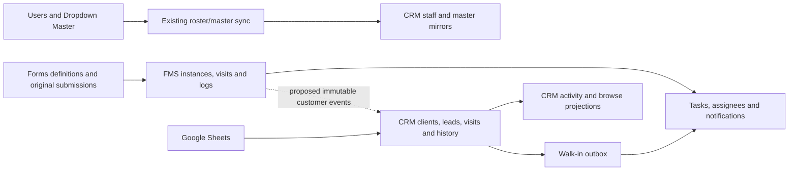

# Supabase data inventory

Captured 2026-10-27 (Asia/Kolkata). Metadata-only read-only hosted audit; no customer answers or file paths were exported.

## Evidence and limits

The JSON catalogs enumerate every captured non-system relation, function signature, non-internal trigger, foreign key, view dependency and Storage bucket, including Supabase-managed schemas. Jobs are captured separately without commands or credentials. Relation sizes include indexes and TOAST. `estimated_rows` is planner metadata, not an exact count; -1 means unknown. Analyze timestamps are maintenance timestamps, not business activity. Empty/old objects are not evidence of redundancy.

Classifications below are conservative triage, with purpose inferred from module and source references unless the critical-contract review below says otherwise. Source references are lexical evidence, not proof that a deployed caller executes a read or write. Dynamic SQL, runtime function-body dependencies, provider delivery, all private grants, per-function business purposes and historical reporting dependencies still require review. This is not a completed deletion audit or a full per-object semantic/dependency audit.

A = operational; B = customer; C = historical/audit; D = derived/cache; E = proven candidate pending approval; F = unclear ownership. No object is currently approved for deletion.

## Critical contracts

| Project | Objects | Purpose and retention |
| --- | --- | --- |
| JewelOS | form_templates, form_fields, form_submissions, form_submission_files | Versioned definitions, original answers and private upload linkage. Retain all evidence. |
| JewelOS | fms_instances, fms_instance_stages, fms_stage_logs, fms_visit_transitions | Running work, visit identities, routing and actual historical transitions. Retain. |
| JewelOS | fms_starter_assignments, fms_workflow_mutation_keys | Exact starter ownership and retry results. Retain; never infer assignments from template IDs. |
| JewelOS | crm_sync.outbox / inbox / walkin_state | Roster/master snapshots and inbound walk-in task delivery. Reuse authentication/leases, not snapshot coalescing for customer history. |
| CRM | clients, client_phone_index, households, referrals | Existing MKC/MKF/MKREF identity and relationships; authoritative customer home. |
| CRM | leads, lead_call_history, lead_stage_history, crm_contacts | Enquiries and explicitly recorded activity; retain individual attempts. |
| CRM | client_timeline, visit_forms, documents, client_edit_log | Visit outcomes, original saved answers, private media links and field-change history. Retain. |
| CRM | crm_private.lead_profile_contributions | Existing provenance and conservative projection evidence. Extend compatibly. |
| CRM | crm_client_activity, crm_client_activity_summary, crm_client_browse_state | Existing invoker activity and incremental bounded browsing. Preserve consumers; derived projection is not source evidence. |
| CRM | crm_private.sync_inbox / sync_outbox / sheet_sync_* | Delivery identity, retries, Sheet mappings, run/error evidence and one-way switch. Retain. |

## Hosted snapshot

### JewelOS

Captured UTC: `2026-10-27T06:18:23.8516+00:00`. 218 relations, 805 function signatures, 185 non-internal triggers. Counts include managed infrastructure.

Schemas: `auth`, `crm`, `crm_private`, `crm_sync`, `cron`, `extensions`, `graphql`, `graphql_public`, `net`, `public`, `realtime`, `storage`, `supabase_migrations`, `vault`.

| Object | Kind | Class / module | RLS | Estimated rows | Total bytes | Source reference (first lexical match) |
| --- | --- | --- | --- | ---: | ---: | --- |
| `auth.audit_log_entries` | r | A / Supabase/platform | True | unknown | 24576 | not established |
| `auth.custom_oauth_providers` | r | A / Supabase/platform | False | unknown | 57344 | not established |
| `auth.flow_state` | r | A / Supabase/platform | True | unknown | 40960 | not established |
| `auth.identities` | r | A / Supabase/platform | True | 83 | 212992 | not established |
| `auth.instances` | r | A / Supabase/platform | True | unknown | 16384 | not established |
| `auth.mfa_amr_claims` | r | A / Supabase/platform | True | 77 | 90112 | not established |
| `auth.mfa_challenges` | r | A / Supabase/platform | True | unknown | 24576 | not established |
| `auth.mfa_factors` | r | A / Supabase/platform | True | unknown | 57344 | not established |
| `auth.mfa_recovery_code_sets` | r | A / Supabase/platform | False | unknown | 24576 | not established |
| `auth.mfa_recovery_codes` | r | A / Supabase/platform | False | unknown | 24576 | not established |
| `auth.oauth_authorizations` | r | A / Supabase/platform | False | unknown | 40960 | not established |
| `auth.oauth_client_states` | r | A / Supabase/platform | False | unknown | 24576 | not established |
| `auth.oauth_clients` | r | A / Supabase/platform | False | unknown | 49152 | not established |
| `auth.oauth_consents` | r | A / Supabase/platform | False | unknown | 49152 | not established |
| `auth.one_time_tokens` | r | A / Supabase/platform | True | unknown | 114688 | not established |
| `auth.refresh_tokens` | r | A / Supabase/platform | True | 133 | 237568 | not established |
| `auth.saml_providers` | r | A / Supabase/platform | True | unknown | 32768 | not established |
| `auth.saml_relay_states` | r | A / Supabase/platform | True | unknown | 40960 | not established |
| `auth.schema_migrations` | r | A / Supabase/platform | True | 77 | 24576 | not established |
| `auth.scim_tokens` | r | A / Supabase/platform | False | unknown | 49152 | not established |
| `auth.scim_users` | r | A / Supabase/platform | False | unknown | 90112 | not established |
| `auth.sessions` | r | A / Supabase/platform | True | 78 | 147456 | not established |
| `auth.sso_domains` | r | A / Supabase/platform | True | unknown | 32768 | not established |
| `auth.sso_providers` | r | A / Supabase/platform | True | unknown | 32768 | not established |
| `auth.users` | r | A / Supabase/platform | True | 83 | 458752 | not established |
| `auth.webauthn_challenges` | r | A / Supabase/platform | False | unknown | 32768 | not established |
| `auth.webauthn_credentials` | r | A / Supabase/platform | False | unknown | 32768 | not established |
| `crm.branches` | r | F / Legacy CRM / integration | True | unknown | 65536 | apps/web/src/types.ts |
| `crm.campaigns` | r | F / Legacy CRM / integration | True | unknown | 81920 | packages/crm-ui/src/lib/supabase/crm-project.types.ts |
| `crm.client_campaign_tags` | r | F / Legacy CRM / integration | True | 2668 | 1236992 | packages/crm-ui/src/lib/supabase/crm-project.types.ts |
| `crm.client_edit_log` | r | F / Legacy CRM / integration | True | 13260 | 4169728 | packages/crm-ui/src/lib/supabase/crm-project.types.ts |
| `crm.client_phone_index` | r | F / Legacy CRM / integration | True | 1642 | 499712 | packages/crm-ui/src/lib/supabase/crm-project.types.ts |
| `crm.client_timeline` | r | F / Legacy CRM / integration | True | 2176 | 2383872 | packages/crm-ui/src/lib/supabase/crm-project.types.ts |
| `crm.clients` | r | F / Legacy CRM / integration | True | 1568 | 1687552 | apps/web/src/embedded/embeddedCrmClient.test.ts |
| `crm.crm_allocation` | r | F / Legacy CRM / integration | True | unknown | 73728 | packages/crm-ui/src/lib/roster.ts |
| `crm.crm_daily_availability` | r | F / Legacy CRM / integration | True | unknown | 24576 | packages/crm-ui/src/lib/supabase/crm-project.types.ts |
| `crm.crm_queue_round_robin` | r | F / Legacy CRM / integration | True | unknown | 24576 | packages/crm-ui/src/lib/supabase/crm-project.types.ts |
| `crm.documents` | r | F / Legacy CRM / integration | True | unknown | 98304 | apps/web/src/features/assistant/knowledge/KnowledgeBaseView.test.tsx |
| `crm.entry_queue` | r | F / Legacy CRM / integration | True | 1123 | 876544 | packages/crm-ui/src/lib/supabase/crm-project.types.ts |
| `crm.lead_call_history` | r | F / Legacy CRM / integration | True | unknown | 32768 | packages/crm-ui/src/components/post-call-inbox.tsx |
| `crm.lead_form_field_options` | r | F / Legacy CRM / integration | True | 18 | 49152 | packages/crm-ui/src/lib/supabase/crm-project.types.ts |
| `crm.lead_form_fields` | r | F / Legacy CRM / integration | True | 26 | 90112 | packages/crm-ui/src/lib/supabase/crm-project.types.ts |
| `crm.lead_stage_history` | r | F / Legacy CRM / integration | True | unknown | 24576 | packages/crm-ui/src/lib/supabase/crm-project.types.ts |
| `crm.leads` | r | F / Legacy CRM / integration | True | unknown | 81920 | apps/web/src/features/fms/FmsStageRunner.guidance.test.tsx |
| `crm.legacy_import_keys` | r | F / Legacy CRM / integration | True | 12970 | 3145728 | packages/crm-ui/src/lib/supabase/crm-project.types.ts |
| `crm.legacy_walkin_ingest_attempts` | r | F / Legacy CRM / integration | True | unknown | 40960 | packages/crm-ui/src/lib/supabase/crm-project.types.ts |
| `crm.legacy_walkin_ingest_rate_limits` | r | F / Legacy CRM / integration | True | unknown | 8192 | packages/crm-ui/src/lib/supabase/crm-project.types.ts |
| `crm.lookup_beverages` | r | F / Legacy CRM / integration | True | 17 | 73728 | packages/crm-ui/src/lib/supabase/crm-project.types.ts |
| `crm.lookup_cities` | r | F / Legacy CRM / integration | True | 101 | 73728 | packages/crm-ui/src/lib/supabase/crm-project.types.ts |
| `crm.lookup_communities` | r | F / Legacy CRM / integration | True | 36 | 106496 | packages/crm-ui/src/lib/supabase/crm-project.types.ts |
| `crm.lookup_gifts` | r | F / Legacy CRM / integration | True | unknown | 73728 | packages/crm-ui/src/lib/supabase/crm-project.types.ts |
| `crm.lookup_not_bought_reasons` | r | F / Legacy CRM / integration | True | unknown | 73728 | packages/crm-ui/src/lib/supabase/crm-project.types.ts |
| `crm.lookup_pincodes` | r | F / Legacy CRM / integration | True | 220 | 114688 | packages/crm-ui/src/components/walk-in-form.tsx |
| `crm.lookup_product_categories` | r | F / Legacy CRM / integration | True | 29 | 106496 | packages/crm-ui/src/lib/supabase/crm-project.types.ts |
| `crm.lookup_relations` | r | F / Legacy CRM / integration | True | 17 | 73728 | packages/crm-ui/src/lib/supabase/crm-project.types.ts |
| `crm.lookup_snacks` | r | F / Legacy CRM / integration | True | unknown | 73728 | packages/crm-ui/src/lib/supabase/crm-project.types.ts |
| `crm.lookup_source_of_leads` | r | F / Legacy CRM / integration | True | unknown | 73728 | packages/crm-ui/src/lib/supabase/crm-project.types.ts |
| `crm.lookup_sugar_options` | r | F / Legacy CRM / integration | True | unknown | 73728 | packages/crm-ui/src/lib/supabase/crm-project.types.ts |
| `crm.not_bought_followups` | r | F / Legacy CRM / integration | True | 841 | 1089536 | packages/crm-ui/src/lib/supabase/crm-project.types.ts |
| `crm.not_bought_history` | r | F / Legacy CRM / integration | True | 166 | 131072 | packages/crm-ui/src/lib/supabase/crm-project.types.ts |
| `crm.referral_calling` | r | F / Legacy CRM / integration | True | unknown | 147456 | packages/crm-ui/src/lib/supabase/crm-project.types.ts |
| `crm.referral_calling_history` | r | F / Legacy CRM / integration | True | unknown | 73728 | packages/crm-ui/src/lib/supabase/crm-project.types.ts |
| `crm.referrals` | r | F / Legacy CRM / integration | True | unknown | 172032 | apps/web/src/features/assistant/KiaraMarkdown.test.tsx |
| `crm.users` | r | F / Legacy CRM / integration | True | unknown | 98304 | apps/web/src/App.tsx |
| `crm.visit_forms` | r | F / Legacy CRM / integration | True | 1987 | 5488640 | packages/crm-ui/src/lib/supabase/crm-project.types.ts |
| `crm_sync.inbox` | r | A / Integration | False | unknown | 49152 | apps/web/src/pages/NotificationsPage.tsx |
| `crm_sync.outbox` | r | A / Integration | False | 448 | 204800 | apps/web/src/embedded/embeddedCrmClient.test.ts |
| `crm_sync.walkin_state` | r | A / Integration | False | unknown | 32768 | supabase/migrations/0196_crm_walkin_tasks.sql |
| `cron.job` | r | A / Supabase/platform | True | unknown | 49152 | not established |
| `cron.job_run_details` | r | A / Supabase/platform | True | unknown | 50364416 | not established |
| `extensions.pg_stat_statements` | v | A / Supabase/platform | False | unknown | - | not established |
| `extensions.pg_stat_statements_info` | v | A / Supabase/platform | False | unknown | - | not established |
| `net._http_response` | r | A / Supabase/platform | False | 828 | 1572864 | not established |
| `net.http_request_queue` | r | A / Supabase/platform | False | 0 | 40960 | not established |
| `public.audit_logs` | r | C / History / accountability | True | 1045649 | 525172736 | supabase/migrations/0001_init_schema.sql |
| `public.branches` | r | F / Ownership review | True | unknown | 49152 | apps/web/src/types.ts |
| `public.buddy_assignments` | r | F / Ownership review | True | 29 | 57344 | supabase/migrations/0001_init_schema.sql |
| `public.client_assignments` | r | F / Legacy CRM / integration | True | unknown | 24576 | supabase/migrations/0012_crm_engine.sql |
| `public.client_contact_aliases` | r | F / Ownership review | True | 1537 | 548864 | supabase/migrations/0012_crm_engine.sql |
| `public.client_followups` | r | F / Legacy CRM / integration | True | unknown | 65536 | supabase/migrations/0001_init_schema.sql |
| `public.client_timeline` | r | F / Legacy CRM / integration | True | 2176 | 2711552 | packages/crm-ui/src/lib/supabase/crm-project.types.ts |
| `public.clients` | r | F / Legacy CRM / integration | True | 1568 | 1228800 | apps/web/src/embedded/embeddedCrmClient.test.ts |
| `public.crm_branch_mappings` | r | F / Legacy CRM / integration | True | unknown | 81920 | supabase/migrations/0071_crm_migration_registry.sql |
| `public.crm_custom_field_values` | r | F / Legacy CRM / integration | True | unknown | 32768 | supabase/migrations/0072_crm_field_definitions.sql |
| `public.crm_documents` | r | F / Legacy CRM / integration | True | unknown | 32768 | supabase/migrations/0012_crm_engine.sql |
| `public.crm_field_definition_revisions` | r | F / Legacy CRM / integration | True | unknown | 24576 | supabase/migrations/0072_crm_field_definitions.sql |
| `public.crm_field_definitions` | r | F / Legacy CRM / integration | True | unknown | 32768 | supabase/migrations/0072_crm_field_definitions.sql |
| `public.crm_identity_review` | r | F / Legacy CRM / integration | True | unknown | 32768 | supabase/migrations/0081_crm_sync_ingestion_contract.sql |
| `public.crm_import_exceptions` | r | F / Legacy CRM / integration | True | 163 | 122880 | supabase/migrations/0075_crm_import_staging_and_exceptions.sql |
| `public.crm_import_records` | r | F / Legacy CRM / integration | True | 3744 | 4505600 | supabase/migrations/0075_crm_import_staging_and_exceptions.sql |
| `public.crm_import_runs` | r | F / Legacy CRM / integration | True | unknown | 24576 | supabase/migrations/0071_crm_migration_registry.sql |
| `public.crm_legacy_people` | r | F / Legacy CRM / integration | True | unknown | 65536 | supabase/migrations/0074_crm_legacy_historical_authors.sql |
| `public.crm_legacy_timeline_details` | r | F / Legacy CRM / integration | True | 2040 | 6479872 | supabase/migrations/0079_preserve_legacy_crm_timeline_details.sql |
| `public.crm_mutation_keys` | r | F / Legacy CRM / integration | True | unknown | 16384 | supabase/migrations/0012_crm_engine.sql |
| `public.crm_source_records` | r | F / Legacy CRM / integration | True | unknown | 32768 | supabase/migrations/0081_crm_sync_ingestion_contract.sql |
| `public.crm_source_systems` | r | F / Legacy CRM / integration | True | unknown | 49152 | supabase/migrations/0071_crm_migration_registry.sql |
| `public.crm_staff_mappings` | r | F / Legacy CRM / integration | True | unknown | 40960 | supabase/migrations/0071_crm_migration_registry.sql |
| `public.crm_sync_checkpoints` | r | F / Legacy CRM / integration | True | unknown | 16384 | supabase/migrations/0081_crm_sync_ingestion_contract.sql |
| `public.crm_sync_operation_requests` | r | F / Legacy CRM / integration | True | unknown | 32768 | supabase/migrations/0081_crm_sync_ingestion_contract.sql |
| `public.crm_sync_runs` | r | F / Legacy CRM / integration | True | unknown | 32768 | supabase/migrations/0081_crm_sync_ingestion_contract.sql |
| `public.crm_sync_worker_assertions` | r | F / Legacy CRM / integration | True | unknown | 16384 | supabase/migrations/0081_crm_sync_ingestion_contract.sql |
| `public.daily_checklist_acknowledgements` | r | F / Ownership review | True | unknown | 81920 | supabase/migrations/0097_designation_daily_checklists.sql |
| `public.dashboard_saved_views` | r | F / Ownership review | True | unknown | 24576 | packages/data/src/analytics/savedViews.ts |
| `public.department_permission_overrides` | r | F / Ownership review | True | unknown | 49152 | supabase/migrations/0199_department_section_access.sql |
| `public.departments` | r | F / Ownership review | True | unknown | 32768 | apps/web/src/types.ts |
| `public.designation_daily_checklists` | r | F / Ownership review | True | unknown | 65536 | supabase/migrations/0097_designation_daily_checklists.sql |
| `public.designation_permission_overrides` | r | F / Ownership review | True | unknown | 49152 | supabase/migrations/0156_granular_permissions_and_section_enforcement.sql |
| `public.dropdown_master_categories` | r | A / Dropdown Master | True | unknown | 65536 | supabase/migrations/0022_dropdown_master_category_registry.sql |
| `public.dropdown_masters` | r | A / Dropdown Master | True | 260 | 212992 | apps/web/src/types.ts |
| `public.export_logs` | r | F / Ownership review | True | unknown | 98304 | packages/core/src/reports/statusOptions.ts |
| `public.fms_ai_requests` | r | A / FMS | True | unknown | 32768 | supabase/migrations/0344_fms_ai_assistant.sql |
| `public.fms_ai_settings` | r | A / FMS | True | unknown | 24576 | supabase/migrations/0344_fms_ai_assistant.sql |
| `public.fms_branch_rules` | r | A / FMS | True | 233 | 253952 | apps/web/src/features/fms/api.ts |
| `public.fms_context_assignee_defaults` | r | A / FMS | True | unknown | 24576 | apps/web/src/features/fms/api.ts |
| `public.fms_diagnostic_events` | r | A / FMS | True | unknown | 32768 | supabase/migrations/0344_fms_ai_assistant.sql |
| `public.fms_evidence` | r | A / FMS | True | unknown | 32768 | apps/web/src/features/fms/api.ts |
| `public.fms_execution_scopes` | r | A / FMS | True | unknown | 24576 | supabase/migrations/0212_fms_loop_execution.sql |
| `public.fms_flows` | r | A / FMS | True | 17 | 131072 | apps/web/src/features/fms/api.ts |
| `public.fms_instance_checklist_items` | r | A / FMS | True | unknown | 40960 | apps/web/src/features/fms/api.ts |
| `public.fms_instance_stage_assignees` | r | A / FMS | True | 40 | 155648 | supabase/migrations/0010_fms_engine.sql |
| `public.fms_instance_stages` | r | A / FMS | True | 55 | 286720 | apps/web/src/features/fms/api.ts |
| `public.fms_instances` | r | A / FMS | True | 14 | 147456 | apps/web/src/features/fms/api.ts |
| `public.fms_join_arrivals` | r | A / FMS | True | unknown | 16384 | supabase/migrations/0212_fms_loop_execution.sql |
| `public.fms_stage_assignees` | r | A / FMS | True | 6 | 114688 | apps/web/src/features/fms/api.ts |
| `public.fms_stage_assignment_decisions` | r | A / FMS | True | unknown | 163840 | supabase/migrations/0262_fms_visit_assignment_decisions.sql |
| `public.fms_stage_assignment_intents` | r | A / FMS | True | unknown | 81920 | supabase/migrations/0262_fms_visit_assignment_decisions.sql |
| `public.fms_stage_logs` | r | C / History / accountability | True | 136 | 131072 | apps/web/src/features/fms/api.ts |
| `public.fms_stages` | r | A / FMS | True | 166 | 221184 | apps/web/src/features/analytics/types.ts |
| `public.fms_starter_assignments` | r | A / FMS | True | 1 | 98304 | packages/data/src/taskControl/bulkDelete.test.ts |
| `public.fms_visit_inputs` | r | A / FMS | True | unknown | 16384 | supabase/migrations/0212_fms_loop_execution.sql |
| `public.fms_visit_transitions` | r | A / FMS | True | 40 | 57344 | supabase/migrations/0212_fms_loop_execution.sql |
| `public.fms_workflow_mutation_keys` | r | C / History / accountability | True | 53 | 139264 | supabase/migrations/0112_integrated_form_fms_workflow_engine.sql |
| `public.form_fields` | r | A / Forms | True | 22 | 131072 | apps/web/src/features/fms/api.ts |
| `public.form_links` | r | A / Forms | True | unknown | 24576 | supabase/migrations/0001_init_schema.sql |
| `public.form_submission_files` | r | A / Forms | True | unknown | 40960 | supabase/migrations/0119_form_file_field_uploads.sql |
| `public.form_submissions` | r | A / Forms | True | 10 | 425984 | apps/web/src/features/forms/api.ts |
| `public.form_templates` | r | A / Forms | True | 2 | 188416 | apps/web/src/features/fms/api.ts |
| `public.kiara_conversations` | r | A / Ask Kiara | True | unknown | 65536 | supabase/migrations/0213_ask_kiara_foundation.sql |
| `public.kiara_daily_usage` | r | A / Ask Kiara | True | unknown | 40960 | supabase/migrations/0213_ask_kiara_foundation.sql |
| `public.kiara_document_chunks` | r | A / Ask Kiara | True | 811 | 2965504 | supabase/migrations/0215_ask_kiara_knowledge.sql |
| `public.kiara_document_versions` | r | A / Ask Kiara | True | 51 | 491520 | supabase/migrations/0215_ask_kiara_knowledge.sql |
| `public.kiara_documents` | r | A / Ask Kiara | True | 51 | 196608 | supabase/migrations/0215_ask_kiara_knowledge.sql |
| `public.kiara_employee_insights` | r | A / Ask Kiara | True | 4 | 49152 | supabase/migrations/0220_ask_kiara_insights_and_limits.sql |
| `public.kiara_escalations` | r | A / Ask Kiara | True | unknown | 98304 | supabase/migrations/0217_ask_kiara_escalations.sql |
| `public.kiara_insight_batches` | r | A / Ask Kiara | True | unknown | 65536 | supabase/migrations/0220_ask_kiara_insights_and_limits.sql |
| `public.kiara_insights_job_config` | r | A / Ask Kiara | True | unknown | 32768 | supabase/migrations/0220_ask_kiara_insights_and_limits.sql |
| `public.kiara_messages` | r | A / Ask Kiara | True | unknown | 229376 | packages/core/src/assistant/escalation.ts |
| `public.kiara_question_facts` | r | A / Ask Kiara | True | 7 | 98304 | supabase/migrations/0213_ask_kiara_foundation.sql |
| `public.kiara_settings` | r | A / Ask Kiara | True | unknown | 24576 | supabase/migrations/0213_ask_kiara_foundation.sql |
| `public.kiara_user_limits` | r | A / Ask Kiara | True | unknown | 16384 | supabase/migrations/0213_ask_kiara_foundation.sql |
| `public.leave_handover_candidates` | v | A / Availability | False | unknown | - | packages/data/src/leave/api.ts |
| `public.leave_requests` | r | A / Availability | True | 3 | 139264 | packages/data/src/leave/api.ts |
| `public.leave_summary_applicants` | v | A / Availability | False | unknown | - | packages/data/src/leave/api.ts |
| `public.notification_deliveries` | r | A / Notifications | True | unknown | 49152 | supabase/migrations/0011_notifications_engine.sql |
| `public.notification_events` | r | A / Notifications | True | 532 | 942080 | supabase/migrations/0011_notifications_engine.sql |
| `public.notification_logs` | r | A / Notifications | True | unknown | 32768 | supabase/migrations/0001_init_schema.sql |
| `public.notification_provider_configuration` | r | A / Notifications | True | unknown | 16384 | supabase/migrations/0011_notifications_engine.sql |
| `public.notification_rules` | r | A / Notifications | True | unknown | 65536 | apps/web/src/features/notifications/api.ts |
| `public.notification_templates` | r | A / Notifications | True | unknown | 49152 | apps/web/src/features/notifications/api.ts |
| `public.notifications` | r | A / Notifications | True | 36561 | 15007744 | apps/web/src/App.tsx |
| `public.performance_snapshots` | r | F / Ownership review | True | unknown | 32768 | supabase/migrations/0001_init_schema.sql |
| `public.permission_catalog` | r | F / Ownership review | True | unknown | 49152 | supabase/migrations/0156_granular_permissions_and_section_enforcement.sql |
| `public.production_demo_data_retirements` | r | F / Ownership review | True | unknown | 81920 | supabase/migrations/0106_production_demo_data_retirement.sql |
| `public.resignations` | r | F / Ownership review | True | unknown | 24576 | apps/web/src/types.ts |
| `public.role_permissions` | r | F / Ownership review | True | unknown | 32768 | packages/data/src/permissions/api.ts |
| `public.settings_mutation_keys` | r | C / History / accountability | True | 116 | 196608 | supabase/migrations/0013_dashboard_reports_settings.sql |
| `public.task_assignees` | r | A / Tasks | True | 16830 | 7626752 | packages/data/src/tasks/api.ts |
| `public.task_attachments` | r | A / Tasks | True | 6 | 114688 | apps/web/src/features/taskEvidence/api.ts |
| `public.task_checklists` | r | A / Tasks | True | 1488 | 1073152 | apps/web/src/features/recurringTodo/model.ts |
| `public.task_comments` | r | A / Tasks | True | unknown | 49152 | supabase/migrations/0001_init_schema.sql |
| `public.task_import_batches` | r | A / Tasks | True | 1 | 81920 | packages/data/src/taskImport/api.ts |
| `public.task_import_identity_aliases` | r | A / Tasks | True | unknown | 65536 | supabase/migrations/0130_task_import_identity_aliases.sql |
| `public.task_import_items` | r | A / Tasks | True | 2295 | 3407872 | supabase/migrations/0101_resumable_current_sheet_task_import.sql |
| `public.task_import_row_registry` | r | A / Tasks | True | 2410 | 2482176 | supabase/migrations/0104_zero_touch_task_import_and_assigning_left.sql |
| `public.task_instances` | r | A / Tasks | True | 18277 | 17711104 | apps/web/src/features/recurringTodo/model.ts |
| `public.task_instances_live` | v | A / Tasks | False | unknown | - | supabase/migrations/0210_task_deleted_read_paths.sql |
| `public.task_revisions` | r | A / Tasks | True | unknown | 24576 | supabase/migrations/0001_init_schema.sql |
| `public.task_templates` | r | A / Tasks | True | 2364 | 1810432 | apps/web/src/App.tsx |
| `public.task_templates_live` | v | A / Tasks | False | unknown | - | supabase/migrations/0210_task_deleted_read_paths.sql |
| `public.task_watchers` | r | A / Tasks | True | unknown | 90112 | apps/web/src/features/tasks/api.ts |
| `public.tenant_realtime_events` | r | D / Read projection / delivery | True | 51955 | 8863744 | apps/web/src/features/settings/DataPurgeCard.test.tsx |
| `public.tenant_section_controls` | r | F / Ownership review | True | 1 | 32768 | supabase/migrations/0051_section_maintenance_controls.sql |
| `public.tenants` | r | F / Ownership review | True | unknown | 49152 | apps/web/src/features/settings/api.ts |
| `public.user_access_profiles` | r | A / Users / access | True | unknown | 16384 | supabase/migrations/0156_granular_permissions_and_section_enforcement.sql |
| `public.user_availability` | r | A / Users / access | True | unknown | 65536 | apps/web/src/features/fms/api.ts |
| `public.user_organization_history` | r | C / History / accountability | True | unknown | 90112 | supabase/migrations/0016_users_hierarchy_and_lifecycle.sql |
| `public.user_permission_overrides` | r | A / Users / access | True | unknown | 49152 | supabase/migrations/0156_granular_permissions_and_section_enforcement.sql |
| `public.user_preferences` | r | A / Users / access | True | unknown | 49152 | apps/web/src/auth/AuthContext.tsx |
| `public.user_profiles` | r | A / Users / access | True | 112 | 499712 | apps/web/src/types.ts |
| `public.username_login_rate_limits` | r | A / Users / access | True | 141 | 188416 | supabase/migrations/0095_username_auth_and_work_identity.sql |
| `public.v_all_tasks` | v | F / Ownership review | False | unknown | - | apps/web/src/features/tasks/api.test.ts |
| `public.v_task_feed_scope` | v | F / Ownership review | False | unknown | - | apps/web/src/features/tasks/api.test.ts |
| `public.v_task_users` | v | F / Ownership review | False | unknown | - | apps/web/src/features/forms/api.ts |
| `public.voice_interpretation_quotas` | r | F / Ownership review | True | unknown | 24576 | supabase/migrations/0162_voice_task_interpretation_quota.sql |
| `public.walkin_entries` | r | F / Ownership review | True | unknown | 57344 | supabase/migrations/0001_init_schema.sql |
| `public.walkin_uploads` | r | F / Ownership review | True | unknown | 32768 | supabase/migrations/0001_init_schema.sql |
| `realtime.messages` | p | A / Supabase/platform | True | unknown | 0 | not established |
| `realtime.messages_2026_10_23` | r | A / Supabase/platform | False | unknown | 24576 | not established |
| `realtime.messages_2026_10_24` | r | A / Supabase/platform | False | unknown | 24576 | not established |
| `realtime.messages_2026_10_25` | r | A / Supabase/platform | False | unknown | 24576 | not established |
| `realtime.messages_2026_10_26` | r | A / Supabase/platform | False | unknown | 24576 | not established |
| `realtime.messages_2026_10_27` | r | A / Supabase/platform | False | unknown | 24576 | not established |
| `realtime.messages_2026_10_28` | r | A / Supabase/platform | False | unknown | 24576 | not established |
| `realtime.messages_2026_10_29` | r | A / Supabase/platform | False | unknown | 24576 | not established |
| `realtime.messages_2026_10_30` | r | A / Supabase/platform | False | unknown | 24576 | not established |
| `realtime.schema_migrations` | r | A / Supabase/platform | False | 81 | 24576 | not established |
| `realtime.subscription` | r | A / Supabase/platform | False | 3 | 155648 | not established |
| `storage.buckets` | r | A / Supabase/platform | True | unknown | 49152 | not established |
| `storage.buckets_analytics` | r | A / Supabase/platform | True | unknown | 24576 | not established |
| `storage.buckets_vectors` | r | A / Supabase/platform | True | unknown | 16384 | not established |
| `storage.migrations` | r | A / Supabase/platform | True | 61 | 73728 | not established |
| `storage.objects` | r | A / Supabase/platform | True | 159 | 712704 | not established |
| `storage.s3_multipart_uploads` | r | A / Supabase/platform | True | unknown | 24576 | not established |
| `storage.s3_multipart_uploads_parts` | r | A / Supabase/platform | True | unknown | 16384 | not established |
| `storage.vector_indexes` | r | A / Supabase/platform | True | unknown | 24576 | not established |
| `supabase_migrations.schema_migrations` | r | A / Supabase/platform | False | 233 | 1343488 | not established |
| `vault.decrypted_secrets` | v | A / Supabase/platform | False | unknown | - | not established |
| `vault.secrets` | r | A / Supabase/platform | False | unknown | 49152 | not established |

Relation kinds: r = table; p = partitioned table; v = view; m = materialized view; f = foreign table. RLS false on a private object is not by itself a browser-access finding; schema USAGE, table grants and exposed API schemas must also be evaluated. Catalogs include anon/authenticated schema and SELECT privilege flags.

| Bucket | Public | Objects | Reported object bytes |
| --- | --- | ---: | ---: |
| `fms-evidence` | False | 0 | 0 |
| `crm-documents` | False | 0 | 0 |
| `report-exports` | False | 4 | 394760 |
| `form-uploads` | False | 0 | 0 |
| `leave-approvals` | False | 18 | 24065476 |
| `crm-legacy-documents` | False | 25 | 24607399 |
| `kiara-knowledge` | False | 58 | 88453375 |
| `task-attachments` | False | 85 | 342655323 |

Object sizes are Storage metadata estimates, not independently verified file bytes or account billing totals. All captured buckets are private. No files were downloaded.

| Scheduled job | Schedule | Active |
| --- | --- | --- |
| `generate-recurring-tasks-daily` | `*/5 * * * *` | True |
| `sync-approved-half-day-leave` | `* * * * *` | True |
| `crm-staff-sync-deliver` | `* * * * *` | True |
| `crm-staff-sync-reconcile` | `0 21 * * *` | True |
| `kiara-insights-nightly` | `0 21 * * *` | True |
| `kiara-insights-collect` | `*/10 * * * *` | True |
| `kiara-retention-purge` | `30 21 * * *` | True |
| `process-report-exports` | `* * * * *` | True |

A job being active does not prove successful execution. Times are stored cron expressions; timezone/settings and run outcomes were not inspected.

### CRM

Captured UTC: `2026-10-27T06:18:28.147443+00:00`. 120 relations, 313 function signatures, 93 non-internal triggers. Counts include managed infrastructure.

Schemas: `auth`, `crm_private`, `cron`, `extensions`, `graphql`, `graphql_public`, `net`, `public`, `realtime`, `storage`, `supabase_migrations`, `vault`.

| Object | Kind | Class / module | RLS | Estimated rows | Total bytes | Source reference (first lexical match) |
| --- | --- | --- | --- | ---: | ---: | --- |
| `auth.audit_log_entries` | r | A / Supabase/platform | True | unknown | 24576 | not established |
| `auth.custom_oauth_providers` | r | A / Supabase/platform | False | unknown | 57344 | not established |
| `auth.flow_state` | r | A / Supabase/platform | True | unknown | 40960 | not established |
| `auth.identities` | r | A / Supabase/platform | True | unknown | 81920 | not established |
| `auth.instances` | r | A / Supabase/platform | True | unknown | 16384 | not established |
| `auth.mfa_amr_claims` | r | A / Supabase/platform | True | 161 | 106496 | not established |
| `auth.mfa_challenges` | r | A / Supabase/platform | True | unknown | 24576 | not established |
| `auth.mfa_factors` | r | A / Supabase/platform | True | unknown | 57344 | not established |
| `auth.mfa_recovery_code_sets` | r | A / Supabase/platform | False | unknown | 24576 | not established |
| `auth.mfa_recovery_codes` | r | A / Supabase/platform | False | unknown | 24576 | not established |
| `auth.oauth_authorizations` | r | A / Supabase/platform | False | unknown | 40960 | not established |
| `auth.oauth_client_states` | r | A / Supabase/platform | False | unknown | 24576 | not established |
| `auth.oauth_clients` | r | A / Supabase/platform | False | unknown | 24576 | not established |
| `auth.oauth_consents` | r | A / Supabase/platform | False | unknown | 49152 | not established |
| `auth.one_time_tokens` | r | A / Supabase/platform | True | 0 | 131072 | not established |
| `auth.refresh_tokens` | r | A / Supabase/platform | True | 272 | 221184 | not established |
| `auth.saml_providers` | r | A / Supabase/platform | True | unknown | 32768 | not established |
| `auth.saml_relay_states` | r | A / Supabase/platform | True | unknown | 40960 | not established |
| `auth.schema_migrations` | r | A / Supabase/platform | True | 77 | 24576 | not established |
| `auth.scim_tokens` | r | A / Supabase/platform | False | unknown | 49152 | not established |
| `auth.scim_users` | r | A / Supabase/platform | False | unknown | 90112 | not established |
| `auth.sessions` | r | A / Supabase/platform | True | 223 | 163840 | not established |
| `auth.sso_domains` | r | A / Supabase/platform | True | unknown | 32768 | not established |
| `auth.sso_providers` | r | A / Supabase/platform | True | unknown | 32768 | not established |
| `auth.users` | r | A / Supabase/platform | True | 10 | 253952 | not established |
| `auth.webauthn_challenges` | r | A / Supabase/platform | False | unknown | 32768 | not established |
| `auth.webauthn_credentials` | r | A / Supabase/platform | False | unknown | 32768 | not established |
| `crm_private.audit_logs` | r | C / History / accountability | True | 5785 | 16244736 | supabase/migrations/0001_init_schema.sql |
| `crm_private.lead_profile_contributions` | r | C / History / accountability | False | unknown | 49152 | supabase-crm/supabase/migrations/20261008000600_crm_lead_continuity.sql |
| `crm_private.master_members` | r | A / Integration | True | 82 | 57344 | supabase-crm/supabase/migrations/20261008000700_crm_jewelos_master_options.sql |
| `crm_private.master_options` | r | A / Integration | True | 220 | 172032 | supabase-crm/supabase/migrations/20261008000700_crm_jewelos_master_options.sql |
| `crm_private.master_snapshot_state` | r | A / Integration | True | unknown | 24576 | supabase-crm/supabase/migrations/20261008000700_crm_jewelos_master_options.sql |
| `crm_private.phone_country_codes` | r | A / Integration | False | 205 | 65536 | packages/crm-ui/src/lib/phone.ts |
| `crm_private.sheet_client_database_master` | v | A / Integration | False | unknown | - | supabase-crm/supabase/migrations/20261006000300_crm_sheet_sync_storage.sql |
| `crm_private.sheet_family_data` | v | A / Integration | False | unknown | - | supabase-crm/supabase/migrations/20261006000300_crm_sheet_sync_storage.sql |
| `crm_private.sheet_referral_parts` | v | A / Integration | False | unknown | - | supabase-crm/supabase/migrations/20261006000300_crm_sheet_sync_storage.sql |
| `crm_private.sheet_referrals` | v | A / Integration | False | unknown | - | supabase-crm/supabase/migrations/20261006000300_crm_sheet_sync_storage.sql |
| `crm_private.sheet_referrals_calling_master` | v | A / Integration | False | unknown | - | supabase-crm/supabase/migrations/20261006000300_crm_sheet_sync_storage.sql |
| `crm_private.sheet_referrals_history` | v | C / History / accountability | False | unknown | - | supabase-crm/supabase/migrations/20261006000300_crm_sheet_sync_storage.sql |
| `crm_private.sheet_sync_errors` | r | A / Integration | False | unknown | 24576 | supabase-crm/supabase/migrations/20261006000300_crm_sheet_sync_storage.sql |
| `crm_private.sheet_sync_outbox` | r | A / Integration | False | unknown | 32768 | supabase-crm/supabase/migrations/20261006000300_crm_sheet_sync_storage.sql |
| `crm_private.sheet_sync_rows` | r | A / Integration | False | unknown | 24576 | supabase-crm/supabase/migrations/20261006000300_crm_sheet_sync_storage.sql |
| `crm_private.sheet_sync_runs` | r | A / Integration | False | unknown | 24576 | supabase-crm/supabase/migrations/20261006000300_crm_sheet_sync_storage.sql |
| `crm_private.sheet_sync_settings` | r | A / Integration | False | unknown | 24576 | supabase-crm/supabase/migrations/20261006000500_crm_sheet_sync_one_way.sql |
| `crm_private.sheet_walkin_dataset` | v | A / Integration | False | unknown | - | supabase-crm/supabase/migrations/20261006000300_crm_sheet_sync_storage.sql |
| `crm_private.staff_links` | r | A / Integration | False | unknown | 49152 | supabase-crm/supabase/migrations/20261005000100_crm_staff_roster_sync.sql |
| `crm_private.staff_sync_runs` | r | A / Integration | False | unknown | 65536 | supabase-crm/supabase/migrations/20261005000100_crm_staff_roster_sync.sql |
| `crm_private.staff_sync_state` | r | A / Integration | False | 82 | 73728 | supabase-crm/supabase/migrations/20261005000100_crm_staff_roster_sync.sql |
| `crm_private.sync_inbox` | r | A / Integration | False | 2335 | 991232 | supabase-crm/supabase/migrations/20261005000100_crm_staff_roster_sync.sql |
| `crm_private.sync_outbox` | r | A / Integration | False | 28 | 98304 | supabase-crm/supabase/migrations/20261005000400_crm_walkin_task_outbox.sql |
| `crm_private.walkin_ingest_keys` | r | A / Integration | False | unknown | 16384 | supabase-crm/supabase/migrations/20261005000200_crm_walkin_ingest.sql |
| `cron.job` | r | A / Supabase/platform | True | unknown | 49152 | not established |
| `cron.job_run_details` | r | A / Supabase/platform | True | unknown | 36339712 | not established |
| `extensions.pg_stat_statements` | v | A / Supabase/platform | False | unknown | - | not established |
| `extensions.pg_stat_statements_info` | v | A / Supabase/platform | False | unknown | - | not established |
| `net._http_response` | r | A / Supabase/platform | False | 720 | 1261568 | not established |
| `net.http_request_queue` | r | A / Supabase/platform | False | 0 | 49152 | not established |
| `public._prisma_migrations` | r | F / Ownership review | True | 36 | 65536 | packages/crm-ui/src/lib/supabase/crm-project.types.ts |
| `public.branches` | r | F / Ownership review | True | 5 | 65536 | apps/web/src/types.ts |
| `public.campaigns` | r | B / CRM | True | unknown | 81920 | packages/crm-ui/src/lib/supabase/crm-project.types.ts |
| `public.client_campaign_tags` | r | B / CRM | True | 2668 | 819200 | packages/crm-ui/src/lib/supabase/crm-project.types.ts |
| `public.client_edit_log` | r | C / History / accountability | True | 23572 | 7282688 | packages/crm-ui/src/lib/supabase/crm-project.types.ts |
| `public.client_identity` | v | B / CRM | False | unknown | - | packages/crm-ui/src/lib/supabase/crm-project.types.ts |
| `public.client_phone_index` | r | B / CRM | True | 1658 | 745472 | packages/crm-ui/src/lib/supabase/crm-project.types.ts |
| `public.client_timeline` | r | B / CRM | True | 2183 | 4136960 | packages/crm-ui/src/lib/supabase/crm-project.types.ts |
| `public.clients` | r | B / CRM | True | 1575 | 7217152 | apps/web/src/embedded/embeddedCrmClient.test.ts |
| `public.crm_allocation` | r | B / CRM | True | 59 | 131072 | packages/crm-ui/src/lib/roster.ts |
| `public.crm_client_activity` | v | B / CRM | False | unknown | - | packages/crm-ui/src/components/client-activity.tsx |
| `public.crm_client_activity_summary` | v | B / CRM | False | unknown | - | packages/crm-ui/src/lib/supabase/crm-project.types.ts |
| `public.crm_client_browse_state` | r | D / Read projection / delivery | True | 1584 | 425984 | packages/crm-ui/src/lib/supabase/crm-project.types.ts |
| `public.crm_client_queue_browse_state` | r | D / Read projection / delivery | True | 811 | 163840 | packages/crm-ui/src/lib/supabase/crm-project.types.ts |
| `public.crm_contacts` | r | B / CRM | True | unknown | 65536 | packages/crm-ui/src/lib/supabase/crm-project.types.ts |
| `public.crm_daily_availability` | r | B / CRM | True | 84 | 98304 | packages/crm-ui/src/lib/supabase/crm-project.types.ts |
| `public.crm_followup_browse_rows` | v | B / CRM | False | unknown | - | packages/crm-ui/src/lib/supabase/crm-project.types.ts |
| `public.crm_queue_round_robin` | r | B / CRM | True | unknown | 24576 | packages/crm-ui/src/lib/supabase/crm-project.types.ts |
| `public.crm_sso_access_audit` | r | C / History / accountability | True | 168 | 106496 | packages/crm-ui/src/lib/supabase/crm-project.types.ts |
| `public.crm_sso_access_grants` | r | B / CRM | True | 35 | 131072 | packages/crm-ui/src/lib/supabase/crm-project.types.ts |
| `public.documents` | r | B / CRM | True | unknown | 98304 | apps/web/src/features/assistant/knowledge/KnowledgeBaseView.test.tsx |
| `public.entry_queue` | r | B / CRM | True | 1135 | 1277952 | packages/crm-ui/src/lib/supabase/crm-project.types.ts |
| `public.households` | r | B / CRM | True | 1575 | 434176 | packages/crm-ui/src/lib/supabase/crm-project.types.ts |
| `public.lead_call_history` | r | C / History / accountability | True | unknown | 40960 | packages/crm-ui/src/components/post-call-inbox.tsx |
| `public.lead_form_field_options` | r | B / CRM | True | unknown | 49152 | packages/crm-ui/src/lib/supabase/crm-project.types.ts |
| `public.lead_form_fields` | r | B / CRM | True | unknown | 49152 | packages/crm-ui/src/lib/supabase/crm-project.types.ts |
| `public.lead_stage_history` | r | C / History / accountability | True | unknown | 32768 | packages/crm-ui/src/lib/supabase/crm-project.types.ts |
| `public.leads` | r | B / CRM | True | 9 | 155648 | apps/web/src/features/fms/FmsStageRunner.guidance.test.tsx |
| `public.legacy_import_keys` | r | C / History / accountability | True | 12970 | 2596864 | packages/crm-ui/src/lib/supabase/crm-project.types.ts |
| `public.legacy_walkin_ingest_attempts` | r | B / CRM | True | unknown | 81920 | packages/crm-ui/src/lib/supabase/crm-project.types.ts |
| `public.legacy_walkin_ingest_rate_limits` | r | B / CRM | True | unknown | 8192 | packages/crm-ui/src/lib/supabase/crm-project.types.ts |
| `public.lookup_beverages` | r | F / Ownership review | True | 17 | 73728 | packages/crm-ui/src/lib/supabase/crm-project.types.ts |
| `public.lookup_cities` | r | F / Ownership review | True | 101 | 57344 | packages/crm-ui/src/lib/supabase/crm-project.types.ts |
| `public.lookup_communities` | r | F / Ownership review | True | 36 | 73728 | packages/crm-ui/src/lib/supabase/crm-project.types.ts |
| `public.lookup_gifts` | r | F / Ownership review | True | 7 | 73728 | packages/crm-ui/src/lib/supabase/crm-project.types.ts |
| `public.lookup_not_bought_reasons` | r | F / Ownership review | True | 16 | 73728 | packages/crm-ui/src/lib/supabase/crm-project.types.ts |
| `public.lookup_pincodes` | r | F / Ownership review | True | 220 | 344064 | packages/crm-ui/src/components/walk-in-form.tsx |
| `public.lookup_product_categories` | r | F / Ownership review | True | 29 | 73728 | packages/crm-ui/src/lib/supabase/crm-project.types.ts |
| `public.lookup_relations` | r | F / Ownership review | True | 17 | 73728 | packages/crm-ui/src/lib/supabase/crm-project.types.ts |
| `public.lookup_snacks` | r | F / Ownership review | True | 12 | 73728 | packages/crm-ui/src/lib/supabase/crm-project.types.ts |
| `public.lookup_source_of_leads` | r | F / Ownership review | True | 16 | 73728 | packages/crm-ui/src/lib/supabase/crm-project.types.ts |
| `public.lookup_sugar_options` | r | F / Ownership review | True | 5 | 73728 | packages/crm-ui/src/lib/supabase/crm-project.types.ts |
| `public.not_bought_followups` | r | B / CRM | True | 844 | 942080 | packages/crm-ui/src/lib/supabase/crm-project.types.ts |
| `public.not_bought_history` | r | C / History / accountability | True | 167 | 163840 | packages/crm-ui/src/lib/supabase/crm-project.types.ts |
| `public.referral_calling` | r | B / CRM | True | 43 | 131072 | packages/crm-ui/src/lib/supabase/crm-project.types.ts |
| `public.referral_calling_history` | r | C / History / accountability | True | 6 | 98304 | packages/crm-ui/src/lib/supabase/crm-project.types.ts |
| `public.referrals` | r | B / CRM | True | 42 | 204800 | apps/web/src/features/assistant/KiaraMarkdown.test.tsx |
| `public.users` | r | A / Users / access | True | 38 | 122880 | apps/web/src/App.tsx |
| `public.visit_forms` | r | B / CRM | True | 1989 | 10829824 | packages/crm-ui/src/lib/supabase/crm-project.types.ts |
| `realtime.messages` | p | A / Supabase/platform | True | unknown | 0 | not established |
| `realtime.schema_migrations` | r | A / Supabase/platform | False | 81 | 24576 | not established |
| `realtime.subscription` | r | A / Supabase/platform | False | unknown | 32768 | not established |
| `storage.buckets` | r | A / Supabase/platform | True | unknown | 49152 | not established |
| `storage.buckets_analytics` | r | A / Supabase/platform | True | unknown | 24576 | not established |
| `storage.buckets_vectors` | r | A / Supabase/platform | True | unknown | 16384 | not established |
| `storage.migrations` | r | A / Supabase/platform | True | 61 | 40960 | not established |
| `storage.objects` | r | A / Supabase/platform | True | 22 | 212992 | not established |
| `storage.s3_multipart_uploads` | r | A / Supabase/platform | True | unknown | 24576 | not established |
| `storage.s3_multipart_uploads_parts` | r | A / Supabase/platform | True | unknown | 16384 | not established |
| `storage.vector_indexes` | r | A / Supabase/platform | True | unknown | 24576 | not established |
| `supabase_migrations.schema_migrations` | r | A / Supabase/platform | False | unknown | 368640 | not established |
| `vault.decrypted_secrets` | v | A / Supabase/platform | False | unknown | - | not established |
| `vault.secrets` | r | A / Supabase/platform | False | unknown | 49152 | not established |

Relation kinds: r = table; p = partitioned table; v = view; m = materialized view; f = foreign table. RLS false on a private object is not by itself a browser-access finding; schema USAGE, table grants and exposed API schemas must also be evaluated. Catalogs include anon/authenticated schema and SELECT privilege flags.

| Bucket | Public | Objects | Reported object bytes |
| --- | --- | ---: | ---: |
| `crm-documents` | False | 31 | 33138378 |

Object sizes are Storage metadata estimates, not independently verified file bytes or account billing totals. All captured buckets are private. No files were downloaded.

| Scheduled job | Schedule | Active |
| --- | --- | --- |
| `crm-sync-deliver` | `* * * * *` | True |
| `crm-staff-sync-deliver` | `* * * * *` | True |
| `crm-staff-sync-reconcile` | `0 21 * * *` | True |

A job being active does not prove successful execution. Times are stored cron expressions; timezone/settings and run outcomes were not inspected.

## Dependency map

## Storage assessment and cleanup proposal

JewelOS audit_logs dominates the inspected relation storage (roughly 501 MiB including indexes). Retention is a business/accountability decision; do not delete or partition it on size alone. Gather growth snapshots, audit consumers and retention requirements first. Task attachments and Kiara knowledge account for most captured object bytes. Maintain private signed access and review existing lifecycle contracts before proposing archival.

| Candidate | Confidence / impact | Required evidence | Archive / rollback |
| --- | --- | --- | --- |
| JewelOS legacy crm schema and public legacy CRM/import structures | F; possible old copies, but retain | Exact counts, ID/hash comparison, dynamic SQL/callers, reports, sync/rollback consumers, approved cutover | Verified encrypted backup, restore drill, explicit retention and separate approval |
| Derived browse/realtime projections | D; consumers currently rely on delivery and paging | Rebuild source coverage, replay boundaries, lag and query-plan evidence | Snapshot/checkpoint plus tested rebuild; no current deletion proposal |
| Delivered/dead sync events | A/C; replay and investigation evidence | Receiver reconciliation, replay horizon, oldest pending/dead age and operational policy | Archive immutable IDs/digests and outcomes; preserve pending/dead work |
| Audit, form submissions, FMS visits/logs and customer history | Essential C/B; retain | Approved retention and reporting requirements | No cleanup recommended in this task |
| Private Storage objects | B/C; keep all captured objects | Link/orphan scan across historical sources, signed access, retention, actual bytes | Copy/checksum/restore verification and explicit approval before any removal |

No table, column, row, bucket, object or migration was deleted, rewritten or applied. Routine next steps are repeated metadata snapshots, query-plan review and dependency review; vacuum/index changes also require impact review rather than being inferred from one snapshot.

## Release boundary

Hosted JewelOS has migrations 0347 (optional Otherwise/form handoff), 0348 (form handoff replacement), 0349 (run names), absent from this checkout; local untracked 0346 is not applied. Same-repository Git commits afa30e0, b436ca0 and dcaff09 contain those later migrations and were read without changing the worktree. CRM linked ledger matches this checkout through 20261023000100. C:/crm has a divergent dirty local migration history, including older filenames/numbers; do not apply that checkout wholesale or renumber applied migrations.

Docker Desktop Linux engine was unavailable during this audit. Local replay/pgTAP, authenticated browser/device flows and end-to-end delivery are not proven. No hosted mutation, deployment or backfill was attempted.
